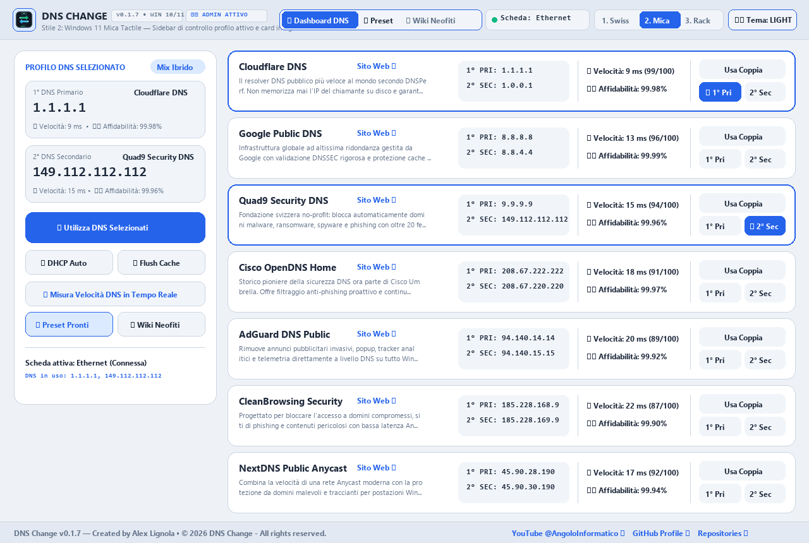
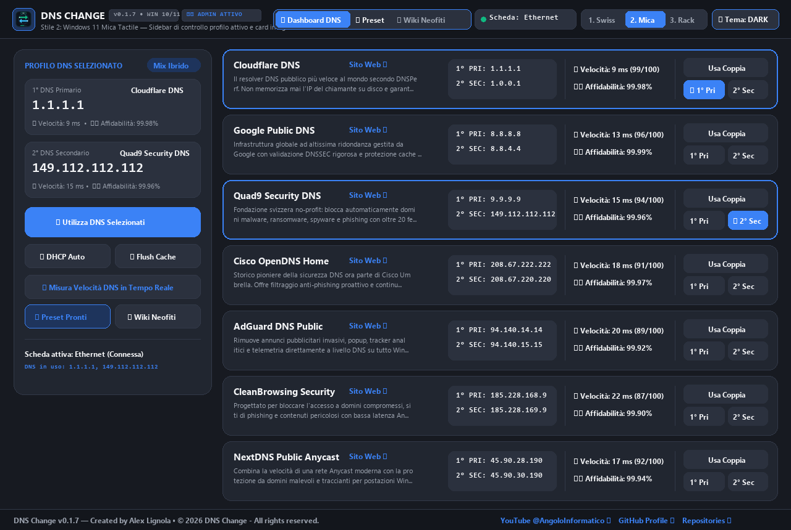

<div align="center">


# DNS Change

**Modern Desktop WebApp per la gestione rapida, l'analisi telemetrica e la combinazione libera dei Server DNS (Primario e Secondario) su PC Windows 10 e Windows 11.**

[](https://github.com/AngoloInformatico)
[](https://www.microsoft.com/windows)
[](https://www.python.org/)
[](https://developer.mozilla.org/en-US/docs/Web/Guide/HTML/HTML5)
[](https://developer.mozilla.org/en-US/docs/Web/CSS)
[](https://developer.mozilla.org/en-US/docs/Web/JavaScript)
[](https://learn.microsoft.com/powershell/)
[](LICENSE)

</div>

---

## Panoramica

**DNS Change** è una WebApp desktop di ultima generazione sviluppata per **Windows 10 e Windows 11** che consente di cambiare con un clic i server **DNS Primario e Secondario** sulle schede di rete attive (`Ethernet`, `Wi-Fi`, ecc.).

Progettata con un'interfaccia professionale multi-stile (**Windows 11 Mica Tactile**, **Swiss Precision Telemetry** e **Industrial Hardware Rack**) e doppia modalità **Dark / Light** (con avvio predefinito in **Mica Light**), offre sia la selezione rapida della **coppia certificata di uno stesso provider**, sia la modalità **Mix Ibrido Multi-Provider** (impostando il **DNS Primario** di un provider e il **DNS Secondario** di un altro provider per massimizzare ridondanza e sicurezza).

---

## Anteprime (Temi Windows 11 Mica Light & Dark)

### Tema Predefinito: Mica Light (`Light Mode`)


### Tema Mica Dark (`Dark Mode`)


---

## ⚡ Caratteristiche Principali

### 🔀 Selezione Flessibile & Routing Ibrido
- **Usa Coppia:** Applica contemporaneamente il DNS Primario e Secondario dello stesso provider.
- **Mix Ibrido Indipendente:** Abbina il **DNS Primario** di un provider (es. *Cloudflare `1.1.1.1`*) con il **DNS Secondario** di un altro (es. *Quad9 `149.112.112.112`* o *Google `8.8.8.8`*) per massimizzare velocità e ridondanza.

### 🌐 Catalogo Resolver DNS Integrati
I 9 provider DNS pubblici più affidabili e veloci al mondo, con telemetria live (**Velocità / Ping** e **Affidabilità %**) e collegamenti diretti alla documentazione ufficiale:

| Provider | DNS Primario (IPv4) | DNS Secondario (IPv4) | Profilo & Specializzazione |
| :--- | :---: | :---: | :--- |
| **Cloudflare DNS** | `1.1.1.1` | `1.0.0.1` | ⚡ *Velocità estrema Anycast & Privacy zero-log* |
| **Google Public DNS** | `8.8.8.8` | `8.8.4.4` | 🌍 *Infrastruttura globale & Validazione DNSSEC rigorosa* |
| **Quad9 Security DNS** | `9.9.9.9` | `149.112.112.112` | 🛡️ *Scudo Anti-Malware, Ransomware & Phishing Svizzero* |
| **Cisco OpenDNS Home** | `208.67.222.222` | `208.67.220.220` | 🏢 *Filtro contenuti & Protezione anti-phishing enterprise* |
| **AdGuard DNS Public** | `94.140.14.14` | `94.140.15.15` | 🚫 *Ad-Block nativo a livello di rete & Blocco traccianti* |
| **CleanBrowsing Security** | `185.228.168.9` | `185.228.169.9` | 👨‍👩‍👧 *Filtro Malware & Protezione per tutta la famiglia* |
| **NextDNS Public Anycast** | `45.90.28.190` | `45.90.30.190` | 🧱 *Firewall DNS moderno con routing reattivo* |
| **Control D Unfiltered** | `76.76.2.0` | `76.76.10.0` | 🚀 *Tecnologia Anycast proprietaria ad altissima efficienza* |
| **Verisign Public DNS** | `64.6.64.6` | `64.6.65.6` | 🏛️ *Stabilità Root Server pura & Zero redirect pubblicitario* |

### 🎨 Design & Esperienza Visiva Curata
- **Layout a Card in Righe Verticali:** Interfaccia ripensata per una lettura immediata; ogni riga mostra chiaramente descrizione, indirizzi IP, indicatori grafici di latenza e pulsanti d'azione rapidi.
- **3 Stili Grafici Selezionabili:**
  - 🪟 **2. Win11 Mica (Predefinito):** Sidebar del profilo attivo e card con angoli smussati in stile nativo Windows 11 (avvio predefinito in modalità **Mica Light**).
  - 📐 **1. Swiss Telemetry:** Griglia tecnica da `1px`, contrasto tipografico netto e indicatori telemetrici ad alta precisione.
  - 🎛️ **3. Hardware Rack:** Display digitale centrale a doppio canale (`CH-01` / `CH-02`) e pulsanti meccanici ad alto contrasto.
- **Temi Dark & Light:** Commutazione istantanea per lavorare comodamente in qualsiasi condizione di luce.
- **Centraggio Automatico:** All'avvio la finestra si posiziona sempre al centro del monitor principale (con supporto per schermi ad alto DPI).
- **Integrazione Icona Completa:** `Icona/icon.ico` nativa sull'eseguibile `.exe`, sulla barra del titolo e sulla barra delle applicazioni di Windows (anche con finestra minimizzata).

### 📖 Guida per Neofiti & Strumenti Rapidi
- **Wiki Interattiva Integrata:** Manuale completo accessibile in un clic (*Cos'è il DNS spiegato semplice*, *Guida in 4 passi*, *Perché fare il mix ibrido*, *Glossario pratico*).
- **🏆 Preset Pronti 1-Click:** Pulsante dedicato nella barra superiore per applicare configurazioni raccomandate (*Gaming & Fibra*, *Protezione Famiglia*, *Ad-Block*, *Mix Privacy + Sicurezza*).
- **Strumenti Windows One-Click:**
  - ⚡ **Utilizza DNS Selezionati:** Applicazione immediata con richiesta di elevazione UAC automatica.
  - 🔄 **DHCP Auto:** Ripristino istantaneo dei DNS automatici dell'operatore.
  - 🧹 **Flush DNS:** Pulizia istantanea della cache locale (`ipconfig /flushdns`).
  - 📡 **Test Ping:** Misurazione parallela della latenza TCP effettiva verso tutti i resolver.
- **🔄 Auto-Incremento Versione (`version.json`):** Tracciamento automatico della versione basato su hash SHA-256 dei file sorgente, per una gestione trasparente sia in locale che su GitHub.

---

## Struttura del Progetto

```text
DNS Change/
├── Icona/
│   └── icon.ico                        # Icona ufficiale multi-risoluzione della WebApp
├── SreenShot/
│   ├── DNS_Change_Light_Theme.png      # Screenshot ufficiale Tema Predefinito (Mica Light)
│   └── DNS_Change_Dark_Theme.png       # Screenshot ufficiale Tema Mica Dark
├── web/
│   └── index.html                      # Frontend WebApp (3 stili, Dark/Light, Wiki e Preset)
├── dist/
│   └── DNS Change.exe                  # Eseguibile standalone per Windows 10/11
├── main.py                             # Avvio WebApp centrata e API nativa Windows 10/11
├── GeneraExe.py                        # Script per compilare l'eseguibile in dist/
├── requirements.txt                    # Dipendenze Python
├── version.json                        # Registro di versione con auto-incremento SHA-256
├── LICENSE                             # Licenza ufficiale del progetto
└── Readme.md                           # Documentazione ufficiale GitHub
```

*(Tutti i file e gli script ausiliari di lavoro e compilazione sono isolati nella cartella `Codex_Work/`, esclusa dal caricamento su GitHub tramite `.gitignore`).*

---

## Installazione e Avvio

### 1. Avvio diretto dell'Eseguibile (`.exe`)
Puoi avviare direttamente l'applicazione compilata per Windows 10/11 presente in:
```text
dist/DNS Change.exe
```

### 2. Avvio da Codice Sorgente Python
Assicurati di avere **Python 3.10+** installato su Windows 10/11:
```powershell
pip install -r requirements.txt
python main.py
```

### 3. Generazione dell'Eseguibile (`GeneraExe.py`)
Per rigenerare autonomamente il file `.exe` all'interno della cartella `dist/`:
```powershell
python GeneraExe.py
```

---

## Licenza

Questo progetto è distribuito sotto i termini specificati nel file [LICENSE](LICENSE) incluso nella repository.

---

## Autore & Copyright

**Created by Alex Lignola - © 2026 DNS Change - All rights reserved.**

- 📺 **YouTube:** [https://www.youtube.com/@AngoloInformatico](https://www.youtube.com/@AngoloInformatico)
- 💻 **GitHub Profile:** [https://github.com/AngoloInformatico](https://github.com/AngoloInformatico)
- 📦 **GitHub Repositories:** [https://github.com/AngoloInformatico?tab=repositories](https://github.com/AngoloInformatico?tab=repositories)
